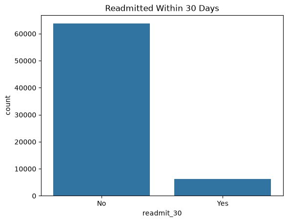
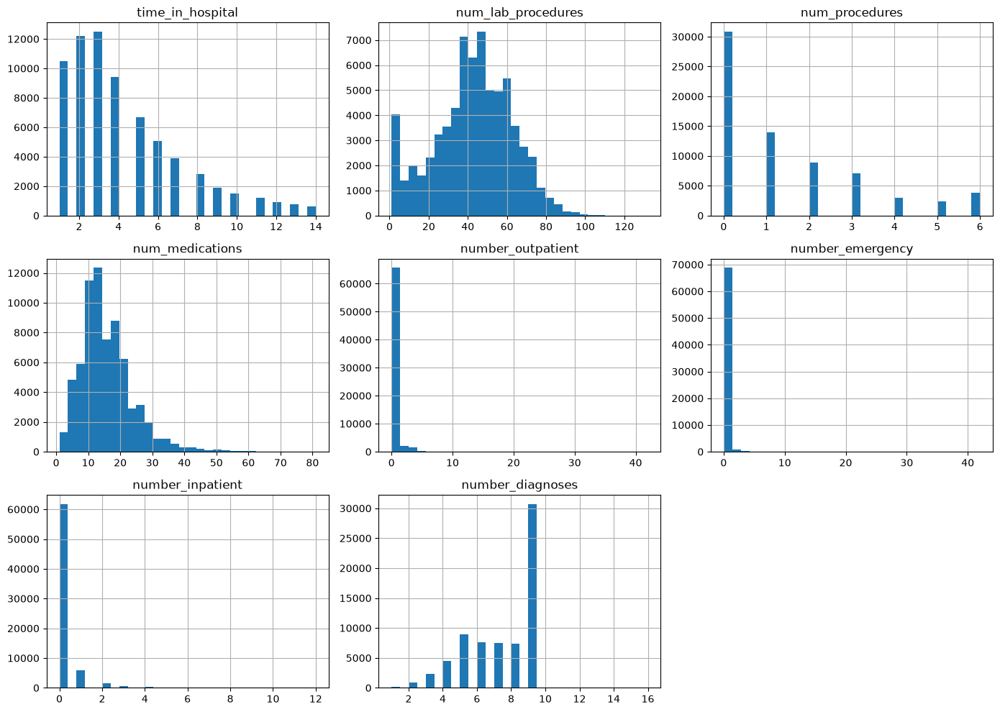
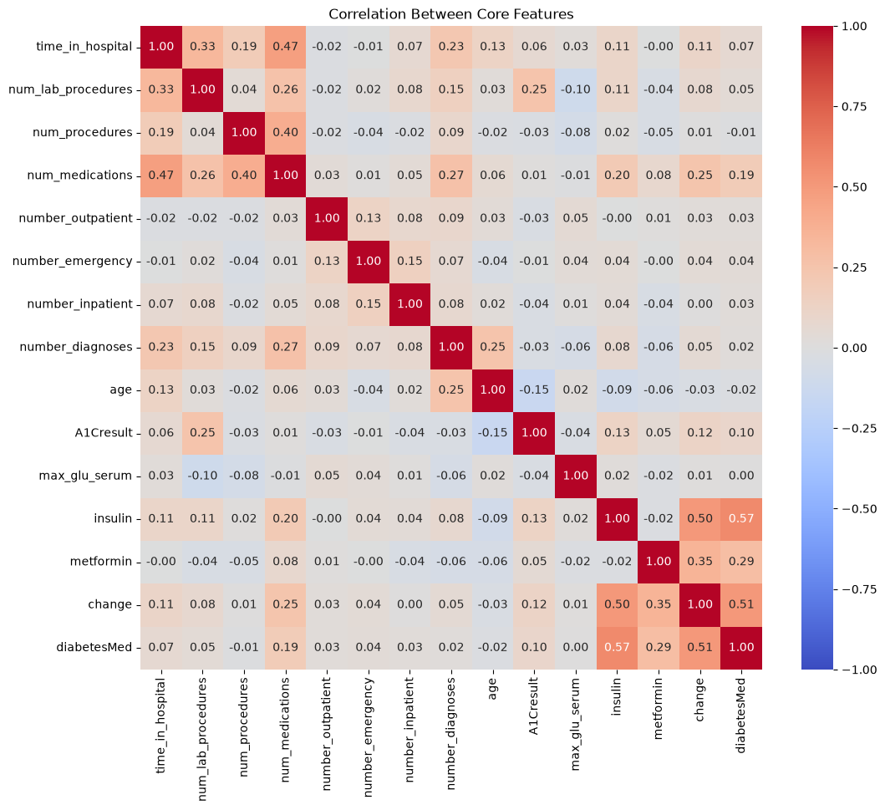
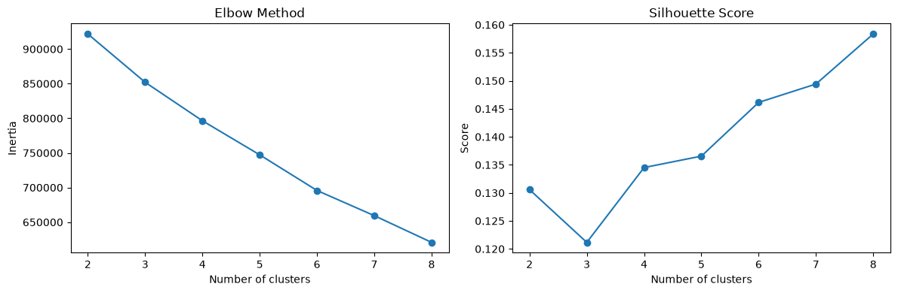
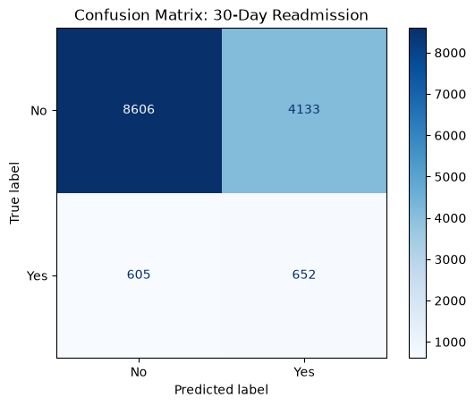
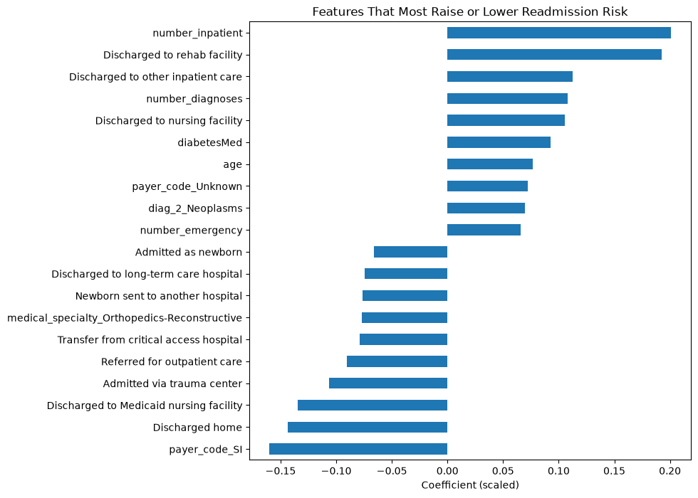

## The Problem

When a patient is readmitted to the hospital within 30 days of leaving, it usually means something went wrong: the treatment didn't hold, follow-up care fell through, or they went home too soon. Readmissions are costly, and Medicare penalizes hospitals with high rates. If hospitals could spot high-risk patients before discharge, they could step in with extra follow-up.

**The question:** can patient data from a hospital stay predict who will be readmitted within 30 days?

**Why this interests me:** I want to work in healthcare IT and data. I interned on Medtronic's Health Data Platform team, and before that I worked as a research analyst comparing pre-surgery imaging to what surgeons actually found. Both jobs showed me how much useful information sits in healthcare data, and how hard it is to turn it into something a hospital can act on. Readmission is a real problem hospitals pay for, so I wanted to see how far a model could get with the kind of data they already collect.

## The Data

I used the [Diabetes 130-US Hospitals dataset](https://archive.ics.uci.edu/dataset/296/diabetes+130-us+hospitals+for+years+1999-2008) from the UCI Machine Learning Repository: about 101,000 hospital stays from 130 US hospitals between 1999 and 2008. Every patient has diabetes, but most were admitted for other reasons, mainly heart problems. Diabetes was the main reason for only about 8% of stays.

Each row includes demographics, length of stay, lab tests, medications, diagnoses, and prior hospital visits.

## Cleaning the Data

The dataset looked complete at first, but it had a few traps:

- **Hidden missing values.** Missing data was stored as "?", so pandas didn't see it. Weight was 97% empty, so I dropped it. Other gaps were filled with "Unknown".
- **"None" isn't missing.** In the blood sugar test columns, "None" means the test wasn't done, which is real information. I made sure pandas didn't treat it as missing.
- **Patients who can't be readmitted.** I removed patients who died or went to hospice.
- **Repeat patients.** Some patients appeared multiple times. I kept only each person's first visit so the same patient couldn't end up in both training and testing.

That left about 70,000 unique patients.

## Exploring the Data

**Only 9% of patients were readmitted within 30 days.** That imbalance shapes everything: a model that always guesses "No" would be 91% accurate and completely useless.

Most features look reasonable, but prior visits are almost always 0 with a long tail (one patient had 42 ER visits in a year). Those patients are real and probably high-risk, so instead of deleting them I capped extreme values at the 99th percentile.

Most features are barely related. The strongest pairs make sense, like insulin and being on diabetes medication. Nothing was redundant enough to drop.

I used K-Means to check for natural patient groups without looking at readmission. There were no strong clusters, so patients sit on a spectrum rather than in clear types. The closest thing to a high-risk group was complex patients with long stays and lots of medications, readmitted at 11.6% vs 9% overall.

## The Model

I trained a logistic regression classifier with balanced class weights, so missing a readmitted patient counts about 10x more than a false alarm. Without that, the model would learn to just say "No".

- **Recall: 52%.** The model catches about half of all readmissions.
- **Precision: 14%.** About 1 in 7 of its "Yes" flags is correct, which is still 1.5x better than flagging patients at random.
- **AUC: 0.64.** Modest but real signal, in line with how hard readmission is to predict.

The biggest risk factor is the number of hospital stays in the past year. Patients discharged to rehab or nursing facilities are also more likely to return, while going home lowers risk.

## What I Learned

Readmission is hard to predict from hospital records alone. A lot of what drives it, like whether patients fill their prescriptions, make follow-up appointments, or have support at home, isn't in the data.

Still, the model would work as a screening tool if a flag triggers something cheap, like a follow-up phone call. And its strongest signals match what hospitals already watch for, which is a good sign it learned something real.

The biggest lesson: **accuracy is the wrong metric for imbalanced problems.** My model's 66% accuracy is lower than guessing "No" every time, but it's the only one that actually catches anyone.

[View the full notebook on GitHub](https://github.com/Jonah-Schwartz521/readmission-project/blob/main/notebooks/readmission.ipynb)